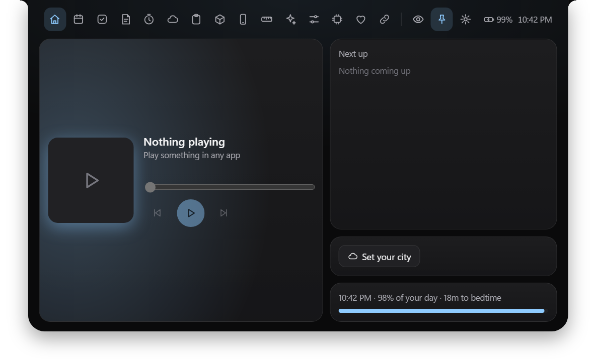
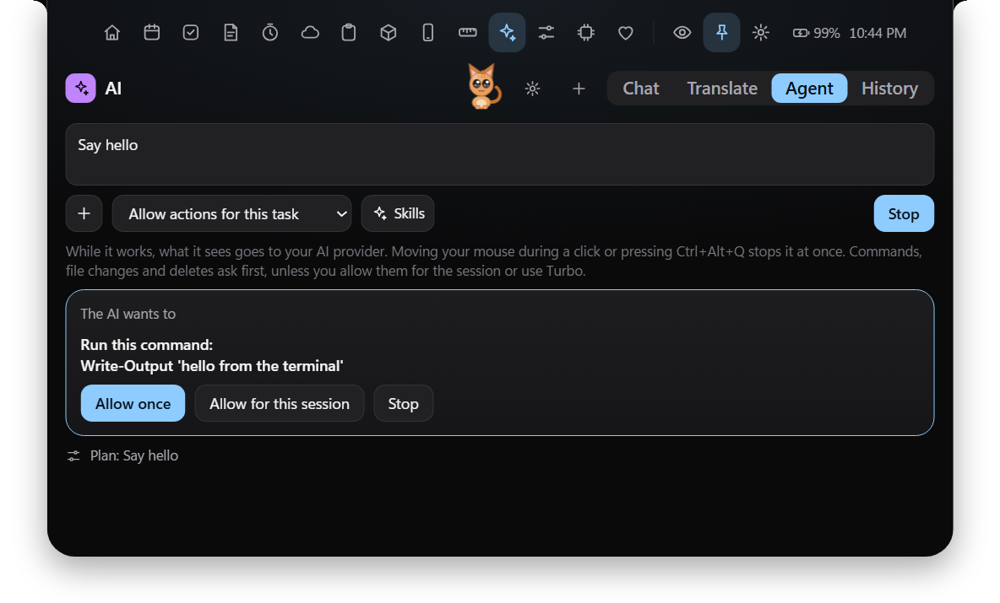
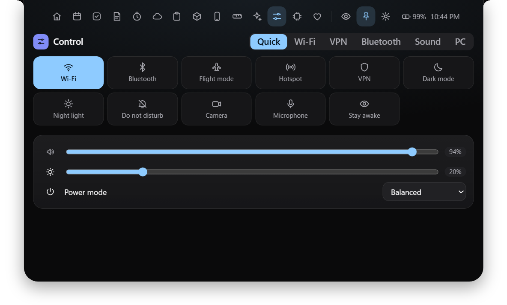
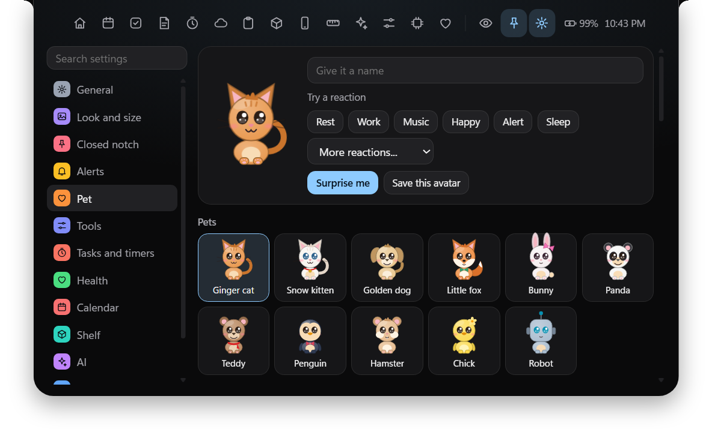
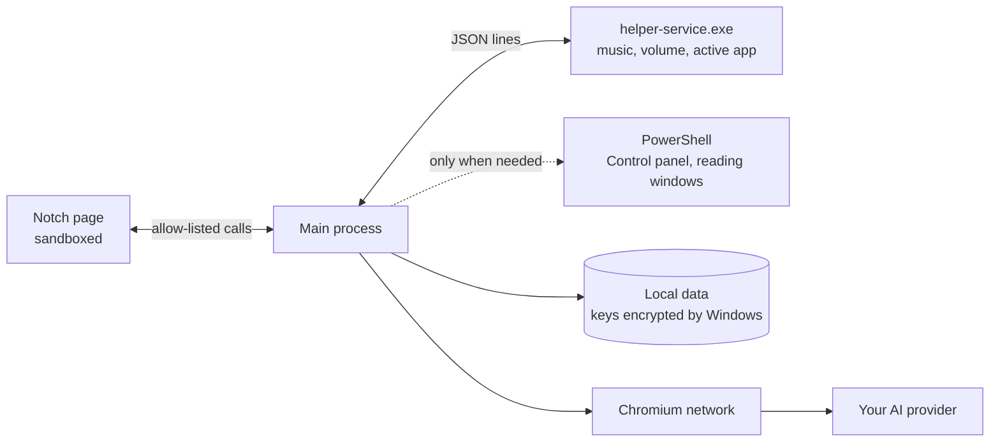

<div align="center">


<br>

[](https://github.com/black-Ari/Magic-Capsule/releases/latest)
[](https://github.com/black-Ari/Magic-Capsule/actions/workflows/ci.yml)
[](#download)
[](LICENSE)

**Your music, tasks, PC controls and an AI that can work on your PC, one hover away.**

[Download](#download) · [Features](#features) · [Privacy](#privacy-and-security) · [Build from source](#build-from-source)

<br>


</div>

Magic Capsule sits at the top of your screen as a small capsule. Point at it and it opens into everything you reach for during the day. No account, no telemetry, and your data stays on your PC.

<div align="center">
  
</div>

## Download

1. Get the installer from the [latest release](https://github.com/black-Ari/Magic-Capsule/releases/latest).
2. Run it. The installer is not code signed yet, so Windows may warn you. Choose **More info**, then **Run anyway**.
3. Move the mouse to the top of the screen, or press **Alt+N**. Press **Esc** to close.

## Features

| | |
|---|---|
| **AI chat** | Gemini, Claude, Ollama, or any API you save. Most APIs work in one click: OpenRouter, Groq, DeepSeek, Mistral, xAI, Together. |
| **AI Agent** | Runs commands, edits files, reads and clicks in any app, uses its own browser and searches the web. It asks first unless you allow it. |
| **Control panel** | Wi-Fi, Bluetooth, hotspot, dark mode, night light, VPN, sound output, power mode, lock, sleep and more. |
| **Daily tools** | Music, calendar, tasks, notes, timers, weather, clipboard, file shelf, units, health and links. |
| **Avatars** | A named companion that walks under the notch and reacts to your apps, music, timers and battery. |
| **Phone** | Scan a QR code and send files, or use your phone as a touchpad, keyboard and remote. Nothing to install. |

<table>
  <tr>
    <td width="33%"></td>
    <td width="33%"></td>
    <td width="33%"></td>
  </tr>
  <tr>
    <td align="center">AI Agent with permissions</td>
    <td align="center">Control panel</td>
    <td align="center">Avatars</td>
  </tr>
</table>

<details>
<summary><b>More about the AI</b></summary>

- **Permissions:** a new chat lets you choose Ask me each time, Allow for this session, or Turbo. Every question also offers Allow for this session for that kind of action.
- **Turbo** never asks: the Agent runs commands, changes files and deletes by itself until you turn it off with the red badge. Ctrl+Alt+Q and moving the mouse still stop it, and it still will not type passwords or pay.
- **Memory and history:** search, reopen or delete past chats and tasks. Tell the AI what to remember, and read or delete every fact in Settings > AI.
- **Long jobs:** the AI keeps a plan, and older steps are summarised so a long task never overflows.
- **Skills:** add your own, set each to Auto, Always or Off, or force one by typing `/skill-name`. GST and ITR skills are included.
- **Tool servers (MCP):** add a server in Settings > AI and its tools work with every AI.
- **Test this API** finds out what a model can really do. A model without tool calling gets text tools, and one that cannot see pictures reads the screen as text.

</details>

<details>
<summary><b>More about the notch</b></summary>

- **Closed notch:** live activities, side extras, lyrics, and alerts for volume, lock keys, battery and reminders.
- **Screens:** the main screen, every screen, one screen, or the screen your mouse is on.
- **Settings:** a searchable menu with look, size, place, shortcuts, auto-hide, pet, tools, backup and privacy.
- **Avatars:** pets, original heroes, Hindu deities, or build your own. Deities use calm reactions. The avatar never reads your keystrokes: in other apps it reacts to the app name and activity only.

</details>

## Light on your PC

Measured idle on an Intel i3 laptop with 8 GB of RAM on Windows 11.

| | Before tuning | Now |
|---|---:|---:|
| Memory | 232 MB | **about 135 MB** |
| Background helper | 62 to 75 MB | **22 MB** |
| Longest frame when opening | 150 ms | **about 50 ms** |

## How it works



It is plain JavaScript on Electron, with no build step for the app. A 21 KB compiled helper watches Windows, and PowerShell starts only for the commands that need it. If the helper ever fails, PowerShell takes over everything.

## Privacy and security

- **API keys** are encrypted with Windows DPAPI and are never put in backups.
- **Data** stays in `%APPDATA%\Magic Capsule`, or in `%APPDATA%\Nook` if you used the app under its old name.
- **Goes online only for:** weather (Open-Meteo), currency rates (open.er-api.com), lyrics when turned on (lrclib.net), your calendar links, your chosen AI provider, and during an agent task, web search (DuckDuckGo), the sites it reads and any tool server you add.
- **The AI Agent** sends what it sees to your AI provider while a task runs: screenshots, window contents, file contents and command output. Text in a password box is never read. It can make mistakes, and a web page or file can try to mislead it, so read each command before you allow it.
- **Clipboard:** items marked private by password managers are not recorded.
- **Phone features** use plain HTTP on your local network, protected by a random link. Use them on your own Wi-Fi only.

See [SECURITY.md](.github/SECURITY.md) to report a problem.

## Build from source

You need Windows 10 or 11 and [Node.js](https://nodejs.org). For the installer you also need [Inno Setup](https://jrsoftware.org/isinfo.php) 6 or 7.

```bat
git clone https://github.com/black-Ari/Magic-Capsule.git
cd Magic-Capsule
run.bat
```

| File | What it does |
|---|---|
| `run.bat` | Starts the app, and runs setup the first time |
| `setup.bat` | Installs dependencies to `%USERPROFILE%\.build_workspaces\poni` |
| `build.bat` | Builds the installer into `dist\` |

Tests and contribution rules are in [CONTRIBUTING.md](.github/CONTRIBUTING.md).

## Known limits

- Tested on Windows 11. Windows 10 is expected to work but has not been tested on a real PC.
- Flight mode here turns off Wi-Fi and Bluetooth, because Windows has no public switch for the real one.
- Only VPNs saved in Windows connect from the app. Apps such as Proton VPN are used from their own window.
- Bluetooth devices are listed here, and pairing stays in Windows Settings.
- Night light, Do not disturb and the sound output use unpublished parts of Windows, so an update could change them.
- The Wi-Fi list needs Windows Location turned on.
- The Agent cannot control apps running as administrator.
- Do not run Poni at the same time: both want Alt+N and the volume keys. You can change the shortcut in Settings > General.

## License

[MIT](LICENSE) © 2026 black-Ari. Inspired by the ideas in Poni and Vayli. All code and artwork here are original.
